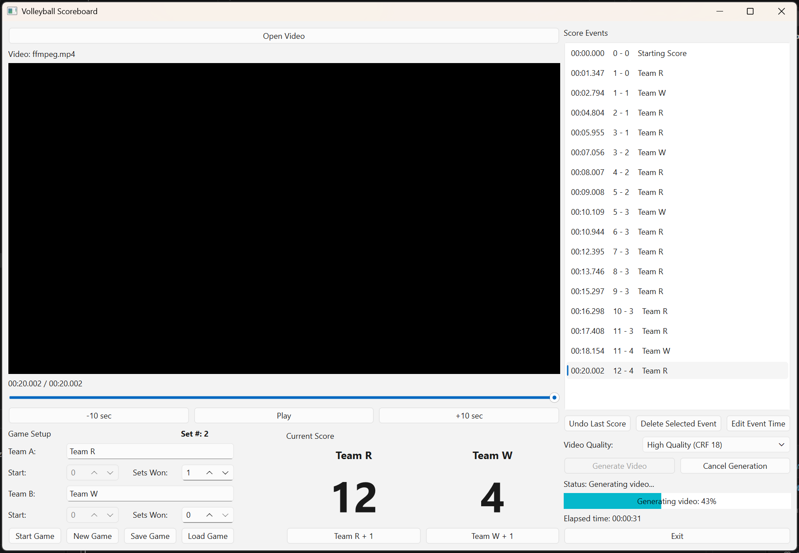
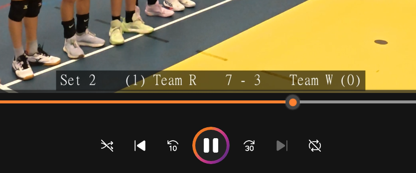

# Volleyball Scoreboard

A Windows desktop application for adding an accurate score timeline to recorded volleyball game videos.

## Download for Windows

**[Download Volleyball Scoreboard v1.1.0](https://github.com/RichardWu2168/volleyball-scoreboard/releases/download/v1.1.0/VolleyballScoreboard-Windows.zip)**

You can also visit the [Releases page](https://github.com/RichardWu2168/volleyball-scoreboard/releases) to download the latest version.

### Requirements

* **Windows:** Download and extract the ZIP package, then run `VolleyballScoreboard.exe`.
* **Python:** Not required to run the packaged application.
* **FFmpeg:** Must be installed separately and added to your Windows `PATH` to generate videos with scoreboard overlays.

See [Installing FFmpeg on Windows](#installing-ffmpeg-on-windows) for instructions.

**Important:** Extract the entire ZIP file and keep all the application files together. Do not move the executable out of its folder.

## Problem

Volleyball games are often recorded on an action camera and uploaded to YouTube for players, coaches, and parents to review. However, the recorded video usually does not contain the game score.

Without a score displayed on the video, it can be difficult to determine the game situation when reviewing a particular rally or play.

This application allows users to record scores while reviewing a video and then automatically overlay the correct score onto a generated video.

## Goals

The application is designed to allow users to:

1. Open a recorded volleyball game video.
2. Play, pause, seek, rewind, and fast-forward through the video.
3. Manually record a score change while watching the video.
4. Automatically capture the video timestamp when a score change is recorded.
5. Maintain the score for both teams throughout the game.
6. Review, edit, and remove previously recorded score events.
7. Save the score timeline and reopen it later.
8. Generate a new video with the current score displayed on the screen.
9. Preserve the original video file without modification during video generation.

## Application



## Scoreboard Overlay

Example of a generated volleyball video with the score displayed on the video.



## Basic Workflow

### 1. Open Video

The user selects a recorded video file, such as an MP4 file from an action camera.

The application displays the video and provides playback controls for reviewing the game.

### 2. Record Scores

While watching the video, the user clicks a button whenever a team wins a point.

For example:

```text
Team A +1
Team B +1
```

The application records the video timestamp and the resulting score.

Example:

```text
00:13:04.250    Team A    13 - 12
00:13:27.800    Team B    13 - 13
00:13:51.420    Team A    14 - 13
```

The score timeline is based on the video's playback position, allowing the score to be displayed at the corresponding time during video generation.

### 3. Review Score Events

The recorded events are displayed in a timeline so the user can review and correct the scoring history.

The application currently supports:

* Adding a score event for either team
* Selecting a recorded event
* Deleting a selected event
* Undoing scoring events added during the current session
* Editing the timestamp of a recorded event
* Recalculating scores after an event is edited or deleted
* Changing team names
* Configuring the starting score before scoring begins
* Tracking the number of sets won by each team

### 4. Save Game Data

The score timeline is saved separately from the video in JSON format.

The saved game data contains:

* Video file information
* Team names
* Starting scores
* Sets won
* Timestamped scoring events
* The team associated with each scoring event
* Resulting scores after each event

When a saved game is opened, the application validates the game data before loading it.

If the original video file is no longer available, the saved game can still be opened. The scoring information and event history are preserved, and the user can select a replacement video without losing the recorded scores.

### 5. Generate Scored Video

After the score timeline is complete, the user can generate a new video.

The application uses the recorded timestamps to determine which score should be displayed at each point in the video.

For example:

```text
00:00:00 - 00:13:04    12 - 12
00:13:04 - 00:13:27    13 - 12
00:13:27 - 00:13:51    13 - 13
00:13:51 - ...         14 - 13
```

The scoreboard displays both team names and their current scores. FFmpeg renders the overlay onto the video and preserves the original audio.

The user can select a video quality setting before generation. The application also displays generation progress and elapsed time and allows the user to cancel an ongoing operation.

The generated video is saved to an output file. The user should choose a different output path from the source video to avoid overwriting the original recording.

## Installing the Windows Application

A packaged Windows version is intended for users who want to use the application without installing Python or setting up a development environment.

### 1. Download the Application

Download the ZIP package provided by the application developer.

Extract the entire ZIP file to a folder on your computer.

**Important:** Keep all files and subdirectories in the extracted application folder together. Do not move the executable out of that folder.

### 2. Install FFmpeg

FFmpeg must be installed separately for video generation. It is not included in the application package.

See [Installing FFmpeg on Windows](#installing-ffmpeg-on-windows) below.

### 3. Launch the Application

Open the extracted application folder and double-click:

```text
VolleyballScoreboard.exe
```

You can create a desktop shortcut for convenient access.

### 4. Start Using the Application

1. Open a volleyball video.
2. Record the scores while reviewing the game.
3. Save the game data so you can continue later.
4. Generate a scored video when the score timeline is complete.

You do not need to install Python to run the packaged Windows application.

## Troubleshooting and Logs

The application writes log messages to help diagnose errors and troubleshoot problems.

The log file is located at:

```text
%LOCALAPPDATA%\VolleyballScoreboard\logs\volleyball_scoreboard.log
```

### How to Find the Log File

1. Press `Win + R` to open the Windows Run dialog.
2. Enter `%LOCALAPPDATA%\VolleyballScoreboard\logs`.
3. Press Enter.
4. Open `volleyball_scoreboard.log` with a text editor, such as Notepad or Notepad++.

If you encounter a problem, check the log file for error messages. When reporting an issue, you can include the log file to help with troubleshooting.

## Installing FFmpeg on Windows

**FFmpeg is required for generating videos with scoreboard overlays.** It is not required for ordinary video playback within the application.

### 1. Download FFmpeg

Download a Windows build of FFmpeg from a trusted source.

### 2. Extract the Files

Extract the downloaded archive to a folder on your computer.

For example:

```text
C:\FFmpeg\
```

The FFmpeg executable should be located inside the `bin` subfolder:

```text
C:\FFmpeg\bin\ffmpeg.exe
```

The actual folder may differ depending on the build you download.

### 3. Add FFmpeg to PATH

Add the folder containing `ffmpeg.exe` to your Windows user or system `PATH` environment variable.

For the example above, add:

```text
C:\FFmpeg\bin
```

Do not add the path to `ffmpeg.exe` itself; add the folder containing the executable.

After updating `PATH`, open a new PowerShell window.

### 4. Verify the Installation

Run:

```powershell
ffmpeg -version
```

If FFmpeg is installed and configured correctly, the command displays version information.

If Windows reports that `ffmpeg` is not recognized, check the installation directory and your `PATH` configuration.

**Important:** Make sure `ffmpeg.exe` is accessible through `PATH` before launching the application if you intend to generate videos.

## Functional Requirements

### Video Playback

* Open a video file
* Play and pause
* Seek to a specific position
* Rewind and fast-forward
* Display the current video time and total duration

### Score Management

* Support two teams
* Configure team names
* Configure starting scores before scoring begins
* Add one point to either team
* Display the current score
* Record the video timestamp for each score change
* Display scoring events in a timeline
* Select a recorded score event
* Undo scoring events added during the current session
* Delete a selected score event
* Edit the timestamp of a recorded score event
* Recalculate scores after event changes
* Track sets won by each team

### Project Management

* Create a new game
* Save game data in JSON format
* Open an existing saved game
* Associate a saved game with a video file
* Validate saved game data before loading it
* Open a saved game even when its original video file is missing
* Select a replacement video without clearing the saved scoring events
* Keep score data separate from the video file

### Video Generation and Scoreboard Overlay

* Generate a new video containing a scoreboard overlay
* Display both team names and their current scores
* Update the displayed score according to the video timestamp
* Preserve the original video's audio
* Select the output video quality
* Display video-generation progress
* Display elapsed generation time
* Cancel video generation
* Use FFmpeg for video processing

## Non-Functional Requirements

* Windows desktop application
* Simple and easy-to-use interface
* Works offline, with FFmpeg available locally
* Score recording should be fast enough to use while reviewing a game
* Support long video files, subject to available system resources and video format
* Validate saved game data and report invalid data
* Handle video-processing errors and cancellation
* Keep the original video separate from the generated output by using a different output path

## Technology

The current implementation uses:

* **Python** — Application programming language
* **PySide6** — Desktop GUI framework
* **FFmpeg** — Video processing and scoreboard overlay
* **JSON** — Game and score data storage
* **PyInstaller** — Packaging the application for Windows

Technology choices may evolve as the project develops.

## Project Structure

```text
volleyball-scoreboard/
├── src/
│   ├── app_logging.py
│   ├── ffmpeg_controller.py
│   ├── game.py
│   ├── main.py
│   ├── project.py
│   ├── scoreboard.py
│   ├── video_controller.py
│   ├── video_generation_controller.py
│   ├── video_generator.py
│   └── video_progress.py
├── examples/
│   └── sample_game.json
├── screenshots/
│   ├── scoreboard.png
│   └── scored-video.png
├── Volleyball.ico
├── Volleyball.png
├── VolleyballScoreboard.spec
├── .gitignore
├── LICENSE
├── README.md
└── requirements.txt
```

The `.venv/`, `build/`, and `dist/` directories are used for local development and packaging. They are not required in the source repository. The Windows distribution ZIP is published separately through GitHub Releases.

## Development Setup

These instructions are for developers who want to run or modify the Python source code.

### Prerequisites

* Windows
* Python
* Git, if cloning the repository
* FFmpeg, if testing video generation

### 1. Clone the Repository

```powershell
git clone https://github.com/RichardWu2168/volleyball-scoreboard.git
cd volleyball-scoreboard
```

### 2. Create a Virtual Environment

```powershell
python -m venv .venv
```

Activate it:

```powershell
.\.venv\Scripts\Activate.ps1
```

### 3. Install Dependencies

```powershell
python -m pip install --upgrade pip
python -m pip install -r requirements.txt
```

### 4. Run the Application

```powershell
python src/main.py
```

## Building the Windows Application

The application can be packaged using PyInstaller.

### 1. Install PyInstaller

Activate the project's virtual environment and run:

```powershell
python -m pip install pyinstaller
```

### 2. Build the Application

From the project root, activate your virtual environment and run:

```powershell
python -m PyInstaller --noconfirm --clean VolleyballScoreboard.spec
```

PyInstaller creates:

* `build/` — Temporary build files.
* `dist/VolleyballScoreboard/` — The packaged Windows application.

The `.spec` file configures the build, including the application icon and image resource.

### 3. Test and Package the Application

Launch:

```text
dist\VolleyballScoreboard\VolleyballScoreboard.exe
```

Test video playback, score recording, saving and loading games, and video generation.

To create the distribution ZIP, run this command in PowerShell from the project root:

```powershell
Compress-Archive `
    -Path .\dist\VolleyballScoreboard `
    -DestinationPath .\dist\VolleyballScoreboard-Windows.zip `
    -Force
```

Distribute the ZIP file rather than the standalone executable, because the packaged application depends on the other files generated by PyInstaller.

FFmpeg is installed separately by each user and is not included in the application package.

### 4. Prepare the Distribution Package

Compress the entire `dist/VolleyballScoreboard/` folder into a ZIP file.

Share that ZIP file with users.

**Do not distribute only `VolleyballScoreboard.exe`.** The packaged application also needs the other files generated by PyInstaller.

FFmpeg is installed separately by each user and is not included in this package.

Before sharing a release, test the extracted ZIP package on another Windows computer to check that the application runs without your development environment.

## Future Improvements

The following features are outside the current version but may be considered later:

* More advanced editing of scoring events, including changing the team or score associated with an event
* Multiple sets with automatic set transitions and set-specific scoring
* Configurable scoreboard position
* Scoreboard themes and styling
* Keyboard shortcuts for playback and score entry
* Export score data to CSV
* Generate YouTube chapters
* Volleyball-specific statistics
* Player information and jersey numbers
* Rally and rotation tracking
* Automatic rally detection using computer vision or AI
* Player recognition
* Automatic score recognition from the original video

## Initial Scope

The first version is intentionally simple:

**Manual score entry + video playback + score timeline + FFmpeg video overlay.**

AI and automatic score recognition are not part of Version 1.

## Status

**Version 1.1.0 — New release**

Version 1.1.0 improves application logging, saved-game validation, and video-generation error handling.

### Current Features

* Video playback and manual score recording.
* Timestamped score events with editing and deletion.
* Saving and loading game data in JSON format.
* Validation of saved game data before loading.
* Recovery of saved games when the original video is missing.
* Selection of a replacement video without losing saved scoring events.
* Scoreboard overlays showing team names and scores.
* Video quality selection, generation progress, and elapsed-time display.
* Video generation cancellation.
* Improved handling and reporting of video-generation errors.
* Application logging to help diagnose errors and troubleshoot problems.
* Prevention of Windows system sleep during video generation.

For downloads and previous releases, visit the [GitHub Releases page](https://github.com/RichardWu2168/volleyball-scoreboard/releases).

Future improvements may include more advanced scoring-event editing, automatic set transitions, keyboard shortcuts, and volleyball statistics.

